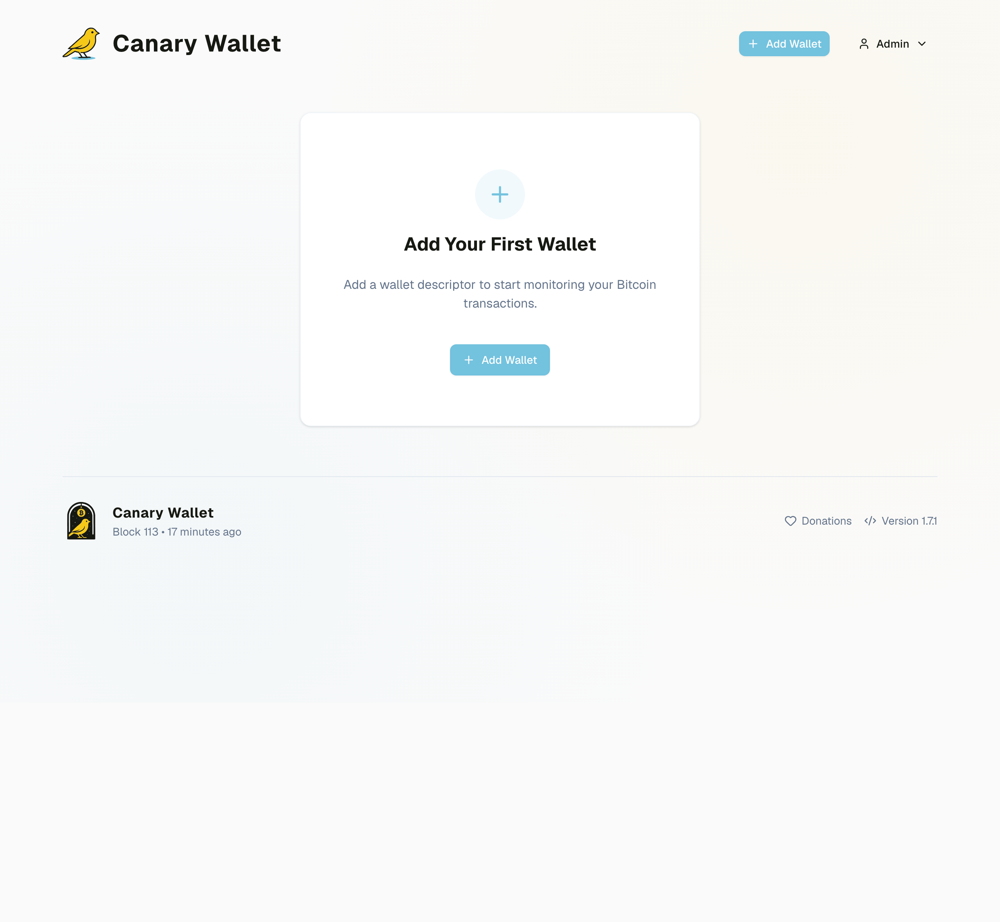
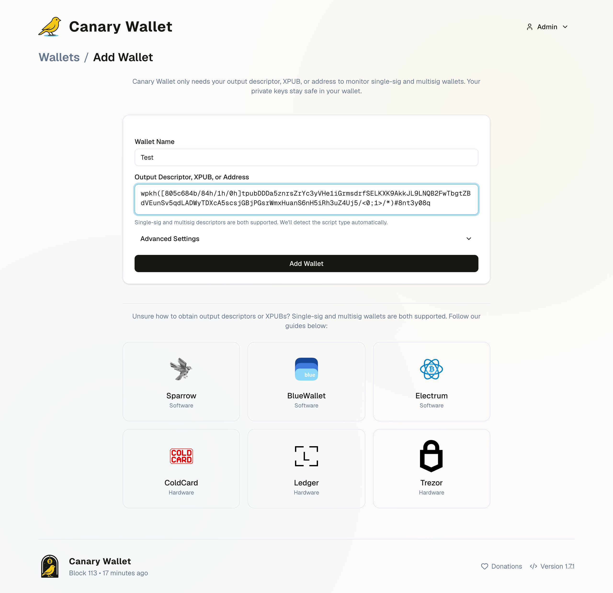
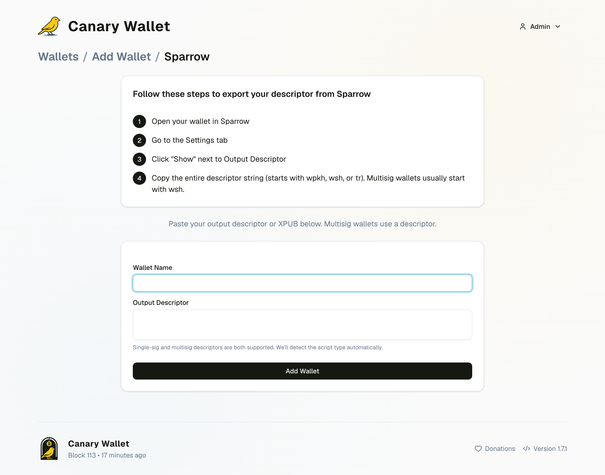
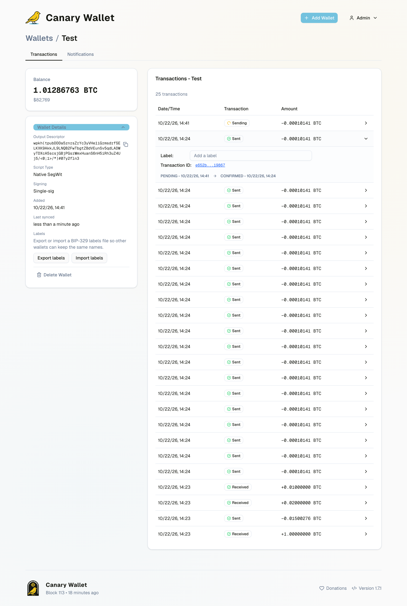
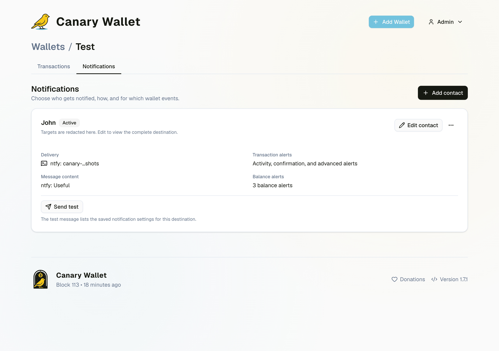
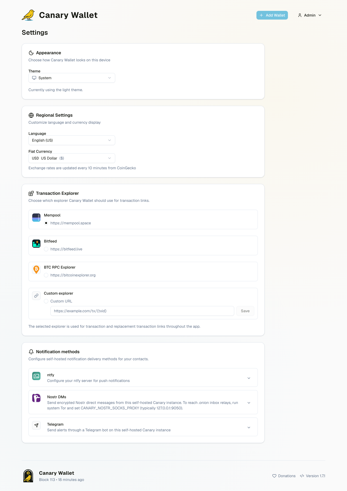

# Canary Wallet


Canary Wallet is a **Bitcoin monitoring and early warning system** built in [Rust](https://www.rust-lang.org/) using [BDK (Bitcoin Development Kit)](https://bitcoindevkit.org/) with a [Next.js](https://nextjs.org/) frontend. It provides real-time transaction intelligence, advanced pattern recognition (RBF, CPFP, consolidation), and instant multilingual notifications for Bitcoin wallet activity - designed specifically for monitoring cold storage and Bitcoin holdings you don't actively use.

## Why Use Canary Wallet?

**A canary in the cold mine** - When your bitcoins are in cold storage, you seldom check on them. Canary Wallet acts as an early warning system that alerts you the moment your coins move, giving you immediate notification of any activity on your wallets.

## Screenshots

### Empty Wallets
Start with a clean watch-only wallet list and add your first wallet when you are ready.


_Start from an empty wallet list and add the first watch-only wallet._

### Add a Wallet
Select your wallet type from popular software wallets (Sparrow, BlueWallet, Electrum) or hardware wallets (ColdCard, Ledger, Trezor). Single-sig and multisig watch-only wallets are both supported. Canary Wallet only needs read-only access to monitor transactions - your private keys stay safe in your wallet.


_Add a read-only descriptor for a wallet named Test._

### Step-by-Step Setup
Follow wallet-specific instructions to export your output descriptor or XPUB. Each supported wallet has tailored guidance to make setup easy.


_Follow the Sparrow-specific guide to export a descriptor safely._

### Wallet Dashboard
View your balance in BTC and fiat and see your complete transaction history with send/receive indicators.


_Monitor balances, pending activity, and transaction details from one dashboard._

### Notifications
Give each contact its own delivery methods, transaction rules, balance alerts, and message-content privacy level.


_Review notification behavior at a glance and open the editor only when changes are needed._

### Settings
Customize your language preference (9 languages supported) and fiat currency display. Exchange rates update automatically via CoinGecko.


_Configure appearance, regional preferences, transaction explorer, and ntfy notifications._

## Key Features

### Watch-only wallets
- Single-sig and multisig wallets
- Output descriptors, XPUBs, and individual addresses
- No seed phrases or private keys

### Transaction Monitoring
- Sending and receiving bitcoin notifications
- Transaction confirmation alerts
- **RBF (Replace-By-Fee)** detection - fee bumping notifications
- **CPFP (Child-Pays-For-Parent)** detection - transaction acceleration notifications

### Balance Alerts
- Configurable threshold alerts (above/below/equals)
- Support for both BTC and fiat currency thresholds
- Smart crossing detection to prevent notification spam
- Auto-disable after firing with manual reactivation

### Notifications
Real-time notifications in 9 languages via **ntfy** push (default public server [ntfy.sh](https://ntfy.sh), or a local server such as the Umbrel ntfy app), encrypted **Nostr DMs**, self-hosted **JSON webhooks**, and optional **Telegram** bot messages.

[canarybitcoin.com](https://canarybitcoin.com) additionally supports **SMS** (via Twilio) and **Email** (via Resend) notifications.

**Supported Languages:** English, Norwegian, Spanish, Portuguese, German, French, Japanese, Danish, Swedish

> **Umbrel / Docker note:** On Umbrel, Canary Wallet auto-detects the local ntfy app through the Docker-internal URL provided by the Umbrel package. You should not need to enter `http://ntfy_app_1` manually. Use "Send Test Notification" in Settings to verify your configuration.
>
With `CANARY_MODE=self-hosted`, custom ntfy URLs can use Docker-internal names (such as `http://ntfy` on a shared Docker network), LAN addresses (such as `http://192.168.1.20:8080`), and Tailscale addresses or MagicDNS names (such as `http://100.64.0.10:8080`). This works on Umbrel, StartOS, myNode, and standalone Docker without an extra flag. Existing saved private URLs work after upgrading. The Canary **backend** must be able to resolve the hostname and reach the server; browser access alone is insufficient. Loopback addresses refer to the backend's own network namespace. Link-local metadata and other special-purpose addresses remain blocked for custom servers. Custom self-hosted ntfy connections bypass HTTP proxy environment settings to connect directly to validated addresses. Detected integrations and operator defaults retain their existing connection behavior.

> **StartOS note:** StartOS packages can provision a scoped local ntfy publisher and pass it to Canary Wallet with `CANARY_NTFY_SERVER_URL`, `CANARY_NTFY_TOKEN`, and `CANARY_NTFY_TOPIC`. These values are used as defaults; settings saved in Canary Wallet remain authoritative.
>
> **Nostr .onion relays:** NIP-17 delivery to `.onion` inbox relays needs system Tor (or equivalent SOCKS5). Set `CANARY_NOSTR_SOCKS_PROXY` to the SOCKS port, typically `127.0.0.1:9050`. Public clearnet relays keep using a direct connection.

## Self-Hosted vs. canarybitcoin.com

| | Self-Hosted | [canarybitcoin.com](https://canarybitcoin.com) |
|---|---|---|
| **Users** | Single user, no auth required | Multi-user with email/password authentication |
| **Notifications** | ntfy + Nostr DM + JSON webhook + Telegram | ntfy + SMS + Email |
| **Billing** | Free | Subscription plans (Personal & Team) |
| **Wallet sync** | Fixed interval | Tier-based (faster sync on higher plans) |

## Quick Start

### Prerequisites
- Rust toolchain (version pinned in [`rust-toolchain.toml`](rust-toolchain.toml))
- Node.js 18+
- Docker and Docker Compose (for local Bitcoin regtest)

### Configuration
```bash
# Backend - choose your mode
cd backend
cp .env.example.self-hosted .env  # or .env.example.cloud

# Frontend
cd frontend
cp .env.example.self-hosted .env.local  # or .env.example.cloud
```

### Development
```bash
# Start local Bitcoin regtest environment
cd scripts && docker-compose up -d

# Start backend (requires Stripe CLI for cloud mode)
cd backend && cargo run

# Start frontend
cd frontend && pnpm dev
```

## Development & Testing

### Displaying Git Version in Footer

The frontend displays the git version and commit hash in the footer. To generate this build info locally:

```bash
# Generate build info (creates src/lib/build-info.json)
cd frontend && node scripts/generate-build-info.js

# Then start the dev server
pnpm dev
```

The footer will display in format: `v0.13.0 • 5e66fe3` (tag and commit) or just the commit hash if no tag exists.

**Note**: The build info is automatically generated during production builds via the webpack configuration. For local development, you need to run the script manually.

### Backend Checks

The Rust toolchain is pinned in [`rust-toolchain.toml`](rust-toolchain.toml), together with clippy and rustfmt; `rustup` installs it on first use. From the repository root, run the backend checks:

```bash
.agent-loop/checks.sh backend
```

This is equivalent to:

```bash
cd backend
cargo fmt --check
cargo clippy --all-targets -- -D warnings
cargo test -- --test-threads=1   # tests share environment and SQLite files
```

CI also builds the documentation with warnings denied:

```bash
cd backend && RUSTDOCFLAGS="-D warnings" cargo doc --no-deps
```

See [backend/ARCHITECTURE.md](backend/ARCHITECTURE.md) for an overview of the backend.

### Running System Tests

System tests start Bitcoin Core and Fulcrum in Docker on regtest, send real transactions and check the events Canary records. They need Docker and the `docker-compose` command, and are marked `#[ignore]`, so `cargo test` skips them.

```bash
cd backend
./run-system-tests.sh              # runs the standard scenarios one file at a time
./run-system-tests.sh --nocapture  # same, with full test output
```

`high_index_scanning` is excluded from the runner because it currently hangs (#633). See [backend/system_tests/README.md](backend/system_tests/README.md) for the full list of scenarios and how to run a single file or test.

## Documentation

See [backend/ARCHITECTURE.md](backend/ARCHITECTURE.md) for the backend architecture: process layout, sync and notification flow, storage, error handling and testing.

[agent-reference.md](agent-reference.md) and [backend/agent-reference.md](backend/agent-reference.md) collect API endpoints, environment variables, database notes and development commands.

See [JSON webhook notifications](docs/webhooks.md) for the self-hosted webhook contract and deployment guidance.

See [Telegram Bot notifications](docs/telegram.md) for bot token setup and destination rules.

## License

See [LICENSE.md](LICENSE.md) for license information.
